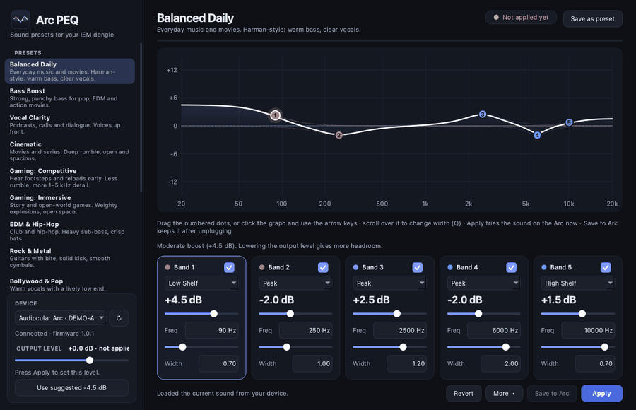
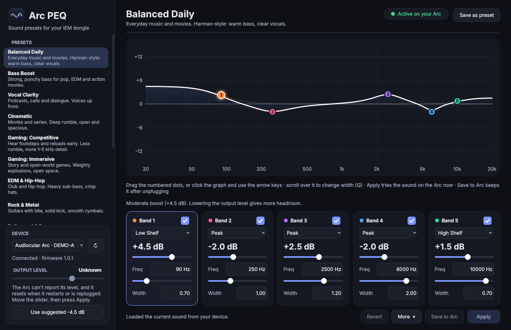
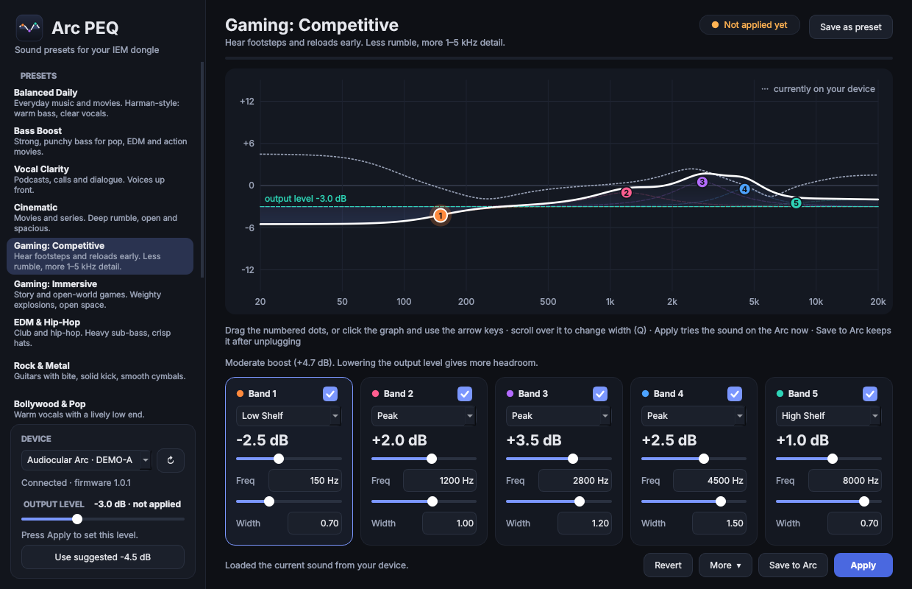

# Arc PEQ

<p align="center"></p>

A small, cross-platform desktop app (macOS, Windows, Linux) for tuning the built-in **5-band parametric EQ** and the
**output level** of the **Audiocular Arc** USB-C IEM dongle, without the vendor's web editor.

<p align="center"></p>

- 12 ready-made sounds, including two gaming modes, plus your own saved presets
- A draggable frequency-response graph that also reflects the output level
- Live **Apply** (instant, nothing is stored) and a separate **Save to Arc** (permanent)
- Automatic backups of what your Arc held, and one-click restore
- Import / export in the common Equalizer APO / AutoEq text format
- Careful by design: range checks, a hard boost cap, confirmations before anything risky

> **Unofficial.** This project is not made by, affiliated with, or endorsed by Audiocular. The USB commands were
> worked out by observing the vendor's web editor. Tested on one Arc, firmware **1.0.1**. Use at your own risk
> (see [Safety](#safety) and the [license](#license)).

| | |
| --- | --- |
|  |  |

*Screenshots are taken in demo mode (`python run.py --demo`). Regenerate them with
`python docs/make_screenshots.py`.*

---

## Contents

1. [Quick start](#quick-start)
2. [Using the app](#using-the-app)
3. [Apply vs Save to Arc](#apply-vs-save-to-arc)
4. [Presets](#presets)
5. [Safety](#safety)
6. [Where your data lives](#where-your-data-lives)
7. [Package it as an app](#package-it-as-an-app)
8. [Platform notes and troubleshooting](#platform-notes-and-troubleshooting)
9. [Command-line tool](#command-line-tool)
10. [How it works (for developers)](#how-it-works-for-developers)
11. [Tests](#tests)
12. [Contributing](#contributing)
13. [License](#license)

---

## Quick start

You need Python 3.10 or newer.

```bash
git clone <your-repo-url> arcpeq_app && cd arcpeq_app
python3 -m venv .venv
source .venv/bin/activate            # Windows: .venv\Scripts\activate
pip install -r requirements.txt
python run.py
```

- Try the interface **without a device** (two pretend ones): `python run.py --demo`
- Close the Audiocular web editor first. Only one program can talk to the Arc at a time.
- Plug in the Arc. It appears in the device picker (bottom left) and its current sound is loaded.

Dependencies: [PySide6](https://pypi.org/project/PySide6/) (Qt for Python) and
[hidapi](https://pypi.org/project/hidapi/) (USB HID access).

## Using the app

**Left column**

- **Presets.** Click one to preview it on the graph. Nothing reaches the Arc yet.
- **Device.** Pick the device; the refresh button looks for devices again. *More > Add device by ID* adds another
  VID:PID from the same maker (it is probed read-only and marked "unverified").
- **Output level.** The Arc's DAC volume, from -6 to +3 dB in 1.5 dB steps. It is *staged* like everything else and
  is sent with **Apply**. The Arc cannot report its level (and resets it when it restarts or is replugged), so the app
  shows **Unknown** until you set it.

**Graph and band cards**

- Drag the numbered dots: left/right changes frequency, up/down changes gain. Scroll over the graph to change the
  selected band's width (Q). Click the graph and use the keyboard: `1`-`5` choose a band, `←/→` frequency, `↑/↓` gain,
  `+/−` width (Shift = bigger steps).
- The white curve is the combined response including the output level. The dashed teal line marks the output level;
  the dotted grey curve is what is on the device right now.
- Each band card has an On switch (Off sets gain to 0; On restores your last gain), the filter type (Peak, Low Shelf,
  High Shelf), gain, frequency and Q (a smaller Q is wider).

**Bottom bar**

| Button | What it does |
| --- | --- |
| **Revert** | Go back to what is on the device right now (also drops a staged level) |
| **More** | Import/export an EQ file, restore from a backup, restore the original sound, add a device |
| **Save to Arc** | Make the current sound permanent (see below) |
| **Apply** (Ctrl/Cmd+Return) | Send the sound and any staged level to the Arc, live |

**Your own presets.** *Save as preset* (top right) keeps the sound under "My Presets". Right-click a preset to load,
update, rename, duplicate, export or delete it. Right-click a built-in one to duplicate it and tune your own copy.

## Apply vs Save to Arc

| | Apply | Save to Arc |
| --- | --- | --- |
| Audible straight away | yes | yes |
| Survives unplugging / power-off | **no** | **yes** |
| Restarts the Arc's USB connection | no | yes, for a few seconds |
| Allowed on unverified devices | after a confirmation | no |

**Apply** writes the five bands (and the staged output level) live. **Save to Arc** then sends the editor's save command
so the Arc stores the sound in its own memory. The Arc restarts its USB connection afterwards (audio briefly goes to
your computer's speakers); the app waits for it, reads the settings back to verify, puts your output level back and
says **"Saved on your Arc"**.

## Presets

| Name | Intent |
| --- | --- |
| Balanced Daily | Everyday music and movies; Harman-style warm bass and clear vocals |
| Bass Boost | Strong, punchy bass for pop, EDM and action movies |
| Vocal Clarity | Podcasts, calls and dialogue |
| Cinematic | Deep rumble, open and spacious |
| Gaming: Competitive | Less rumble, more 1-5 kHz detail for footsteps and reloads |
| Gaming: Immersive | Weighty explosions and open space for story games |
| EDM & Hip-Hop | Heavy sub-bass, crisp hats |
| Rock & Metal | Guitars with bite, solid kick, smooth cymbals |
| Bollywood & Pop | Warm vocals with a lively low end |
| Acoustic & Classical | Natural and airy |
| Late Night | Quiet listening that keeps bass and detail alive |
| Smooth & Easy | Relaxed, less tiring tuning for long sessions |

All built-in presets stay under 9 dB of total boost. They are starting points: in-ear monitors and ears differ, so
adjust to taste.

## Safety

The Arc drives in-ear monitors directly, so the app is cautious.

- **Hard boost cap.** The combined boost may not exceed **15 dB**; the app refuses to send more. Anything above
  **9 dB** asks for confirmation and offers "Apply and set level to a safer value".
- **Everything is validated first.** All five bands are range-checked before the first byte is written. Frequency,
  Q and gain have fixed limits; values read from files or the device are checked the same way.
- **Verified devices only for saving.** Only the known model and firmware (Arc, 1.0.1) can be saved to flash. Other
  devices or firmware need a confirmation to write live and can't be saved.
- **Output level is staged and guarded.** It is only sent on Apply. If the app doesn't know the current level and you
  raise it, it asks first.
- **Failures are never hidden.** A write that fails part-way marks the device "unknown", re-reads it and tells you.
- **Backups.** The first time the app reads a device it stores what the device held; the very first backup per device
  is pinned and never deleted, the 20 newest others are kept. Settings the app can't decode are kept as a raw note.
- **Imported files** are size-limited and parsed strictly; names are shown as plain text.
- No network access, no telemetry.

Hearing safety: when trying a new sound, start with the earphones out or the level low, and raise gradually.

## Where your data lives

All in a private folder, `~/.arcpeq/` (Windows: your user profile):

| File | Contents |
| --- | --- |
| `presets.json` | Your saved presets |
| `prefs.json` | Small UI preferences (e.g. intro dismissed) |
| `devices.json` | Extra VID:PID pairs you added |
| `backups/` | Automatic device backups (JSON) and raw notes |
| `arcpeq.log` | Rotating log, useful when reporting a problem |

Files are written atomically and with private permissions. A corrupt `presets.json` is kept next to the original as
`presets.json.<time>.bad` instead of being overwritten.

## Package it as an app

Build on the OS you are building for (PyInstaller does not cross-compile). Python 3.10+ is required.

| OS | Command | Result |
| --- | --- | --- |
| macOS | `bash packaging/build_mac.sh` | `dist/Arc PEQ.app` (ad-hoc signed) |
| Windows | `packaging\build_windows.bat` | `dist\ArcPEQ\ArcPEQ.exe` (copy the whole folder) |
| Linux | `bash packaging/build_linux.sh` | `dist/ArcPEQ/ArcPEQ` |

Each script creates `.venv`, installs the requirements plus PyInstaller and Pillow, generates the icon files from the
in-code logo, and runs `packaging/arcpeq.spec`.

On macOS, drag the app to Applications and, the first time, **right-click > Open** (it is signed ad hoc, not
notarised by Apple). Sharing it with others properly needs an Apple Developer ID, code signing and notarisation.
Windows may show a SmartScreen warning for unsigned builds.

## Platform notes and troubleshooting

- **macOS can't see the Arc.** Allow the app (or Terminal, when running from source) in *System Settings > Privacy &
  Security > Input Monitoring*, then restart it.
- **Linux permissions.** Give your desktop user access with a udev rule, then reload:

  ```bash
  echo 'KERNEL=="hidraw*", SUBSYSTEM=="hidraw", ATTRS{idVendor}=="3302", ATTRS{idProduct}=="20e9", TAG+="uaccess"' \
    | sudo tee /etc/udev/rules.d/99-arc.rules
  sudo udevadm control --reload-rules && sudo udevadm trigger
  ```
- **"Couldn't talk to the device" / read errors.** Close the Audiocular web editor, check the cable, press the refresh
  button, or unplug and replug the Arc. Details are in `~/.arcpeq/arcpeq.log`.
- **Audio drops for a few seconds after Save to Arc.** Expected: the Arc restarts its USB connection when it stores
  settings.
- **Output level shows "Unknown".** The Arc can't report its level and resets it on restart or replug. Move the slider
  and press Apply to set it.
- **Two identical Arcs without serial numbers.** The app can't tell them apart; unplug one.

## Command-line tool

`tools/arc_peq.py` is a standalone script (no GUI) for testing and diagnostics:

```bash
python tools/arc_peq.py list
python tools/arc_peq.py read
python tools/arc_peq.py write --preset bass_vocals_v1 --yes            # live only
python tools/arc_peq.py write --preset bass_vocals_v1 --yes --save     # also stored on the Arc
python tools/arc_peq.py probe                                          # read two registers, no writes
```

Pass both `--vid` and `--pid`, or neither. `tools/diag.py` and `tools/diag2.py` are the diagnostic scripts used while
developing; they are not needed for normal use.

## How it works (for developers)

### Project layout

```
arcpeq/
  core.py      Protocol encoding, filter maths, presets, validation, files, backups, EQ import/export (no Qt, no USB)
  device.py    USB HID access: Session (one open device), RealBackend (hidapi), DemoBackend (pretend devices)
  widgets.py   CurveWidget (the graph) and BandCard (one band's controls)
  app.py       Controller (background I/O) and MainWindow (the screen, staged state, safety rules)
  logo.py      The logo, drawn in code
packaging/     PyInstaller spec, build scripts, generated icons
tests/         Unit tests and offscreen GUI tests
tools/         Command-line tool and diagnostics
run.py         Entry point
```

Dependencies point one way: `app` → `widgets`/`device` → `core`. `core` knows nothing about Qt or USB, so it is easy to
test.

### The USB protocol

The Arc exposes a vendor HID interface (VID `0x3302`, PID `0x20E9`). Every exchange is one report, ID `0x4B`, with 10
data bytes: `[cmd, 0, 0, 0, rw, 0, p0, p1, p2, p3]`, where `rw` is `0x52` read, `0x57` write or `0x53` save. A write is
acknowledged with payload `03 00 00 00`.

| Command | Meaning |
| --- | --- |
| `0x26 + 2i` | Band *i* (0-4): gain (int16, 0.1 dB) and frequency (uint16, Hz) |
| `0x27 + 2i` | Band *i*: Q × 1000 (uint16) and type (uint16: 8 peak, 11 low shelf, 12 high shelf) |
| `0x04`, `0x05` | Firmware version |
| `0x3B` | Output level (steps 9-15 = -6 to +3 dB, 13 = 0 dB; write-only, instant) |
| `0x02`, `0x24` | Apply handshake registers (`0x65` and `1`) |

**Apply** is: write `0x02 = 0x65`, the ten band writes, `0x24 = 1`, `0x02 = 0x65`. **Save** is the `S` command on `0x26`
carrying Band 1's current bytes; the Arc then restarts its USB connection.

### Threading model

USB calls can take seconds, so `Controller` runs them on a single worker thread (`ThreadPoolExecutor(1)`) and answers
through Qt signals; `MainWindow` never touches the device itself. A `HID_LOCK` serialises hidapi calls. While a dialog is
open the controller is paused so the device list doesn't change underneath it. A watchdog on the UI side reports a job
that takes too long.

### State model

The window keeps a *draft*: `bands` (on screen), `device_bands` (what the device holds) and `vol_pending` (staged
level). Apply and Save send the draft and re-read the device to confirm. Per-device sets track which devices are
`unsaved` (live but not stored), `uncertain` (a write failed part-way), or hold unsupported settings.

### Gotchas worth knowing

- `hidapi`'s `read(64, 0)` blocks forever (timeout 0 means block). The code always passes at least 1 ms.
- After a save the Arc re-attaches with new HID paths, so the app re-finds the device by its key, not its path.
- Qt style sheets can't draw a check mark; the tick image is generated at start-up into the data folder.

### Adding a preset

Add a `_p(id, name, detail, [(type, freq, q, gain), ...])` entry to `LIBRARY` in `core.py` with five bands. The tests
check every built-in preset is valid and stays within the boost limit.

## Tests

```bash
python -m unittest discover -s tests                        # unit tests: protocol, validation, presets, backups
QT_QPA_PLATFORM=offscreen python tests/gui_smoke.py         # safety gates end to end, no screen needed
QT_QPA_PLATFORM=offscreen python tests/gui_drag.py          # real mouse drags on every slider
QT_QPA_PLATFORM=offscreen python tests/gui_flows.py         # 12 user flows against the demo backend (~2 minutes)
```

The GUI tests use the in-memory demo backend, so they never touch real hardware.

## Contributing

Issues and pull requests are welcome. Please keep changes small, add or update a test, run the suites above, and be
conservative about anything that writes to the device: confirm behaviour on hardware before changing the protocol code,
and never loosen the validation or the boost cap.

## License

MIT. See [LICENSE](LICENSE). Copyright (c) 2026 Bharat Nanda.
